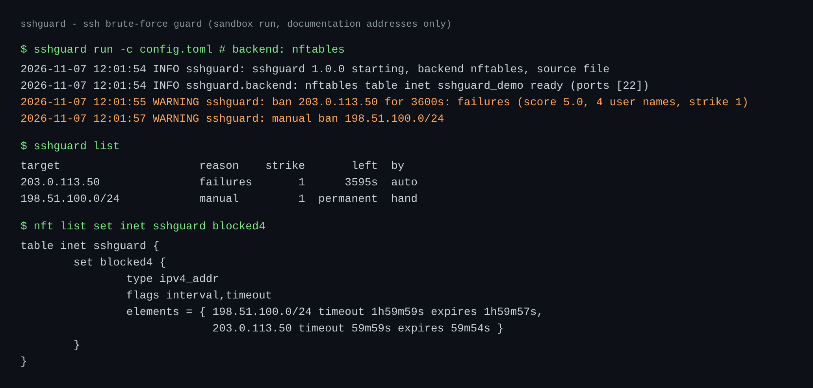
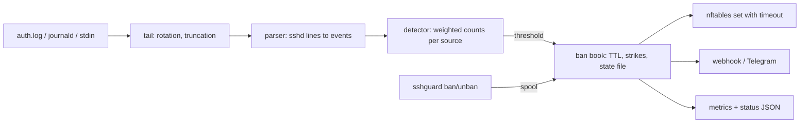

# sshguard - SSH brute-force guard

[](https://github.com/TexAlphaWolf/sec-ssh-bruteforce-guard/actions/workflows/ci.yml)
[](https://github.com/TexAlphaWolf/sec-ssh-bruteforce-guard/actions/workflows/codeql.yml)


A small daemon that reads the sshd log, recognises sources that keep failing and bans them in the **kernel firewall (nftables)**. Standard library only, no runtime dependencies. Bans expire by themselves, repeat offenders wait longer, and a fresh install starts in **dry-run**: it says what it would ban and blocks nothing, so it cannot lock you out.



*One run in a sandbox with documentation addresses only (RFC 5737); the three outputs come from the same session, the nft table name is shortened for the picture.*

## Why this and not fail2ban

fail2ban is the right answer for most servers. This project exists to show how the thing works and to make a few different choices:

| | sshguard |
|---|---|
| Enforcement | one nftables set per family with **per-element timeouts**: the kernel lifts the ban, even if the daemon is down |
| IPv6 | counted and banned per **/64**, because one rented /64 is a million addresses |
| Log injection | patterns are matched from the **end** of the line, so a user name like `x from 9.9.9.9 port 1` cannot get an innocent address banned (tested) |
| Typos | a successful login **forgives that user's** earlier failures: honest typos, even from a shared office address, never add up |
| Slow attacks | a second, 24-hour window catches "one try every half hour" |
| Safety | dry-run by default, allowlist, validated addresses only (no shell, ever), strict config (a typo in a key is an error) |
| Observability | Prometheus textfile + status JSON, JSON logs, `sshguard scan` to replay any log offline |

## Quick start

```bash
# 1. See what it would do on your own logs, without touching anything
pip install .
sshguard scan /var/log/auth.log            # add --year 2026 for old syslog files, .gz works

# 2. Run it as a service in DRY-RUN (hardened systemd unit, own user)
sudo sh deploy/install.sh
journalctl -u sshguard -f

# 3. When the log looks right: /etc/sshguard/config.toml -> [backend] kind = "nftables"
sudo systemctl restart sshguard
sudo nft list set inet sshguard blocked4
```

With Docker (dry-run; `SSHGUARD_BACKEND=nftables` to really block): `docker compose up -d && docker compose logs -f`.

Add your own address and anything that opens port 22 on purpose (VPN, load balancer, monitoring) to `[allowlist]` **before** enabling nftables: a TCP health check every minute looks exactly like a probe flood (see the results below).

## Commands

```
sshguard run -c config.toml       the daemon
sshguard scan FILE...             replay logs, report what would be banned (--json)
sshguard list                     active bans
sshguard ban 198.51.100.0/24 --ttl 2h
sshguard unban 203.0.113.50 [--forgive]
sshguard check-config -c config.toml
```

`ban` and `unban` leave a command file in a spool directory that the running daemon reads (only files owned by root or the daemon's user, not writable by others); `--offline` edits the state file instead.

## How it works



Every event has a weight: wrong password 1.0, a client that named a user and left before logging in 0.5, a bare connect-and-leave probe 0.2. **5 weighted failures in 10 minutes** (or 15 in 24 hours, or 10 different user names in 10 minutes) ban the source for **1 hour**; each repeat is 4 times longer, up to 7 days. Everything is in [docs/configuration.md](docs/configuration.md).

## Measured results

A reproducible synthetic day (`tools/attack_sim.py`, seed 7): 157 labelled sources, 15,194 log lines. Attackers of six kinds, and honest users: typos, "4 wrong passwords then the right one", a deploy bot, 30 colleagues behind one NAT address, a load balancer health check every minute.

| Source type | Sources | Banned | Events let through before the ban |
|---|---:|---:|---:|
| brute_force | 30 | 30 | 6.0 |
| spraying (one try per name) | 10 | 10 | 5 |
| low_and_slow (one try / 25-40 min) | 10 | 10 | 15 |
| ipv6_rotation (random address in a /64) | 5 | 5 | 5 |
| key_only_probe (password login off) | 10 | 10 | 10 |
| probe_flood (no login attempt) | 10 | 10 | 25 |
| noise (scanner touches the port once or twice) | 40 | 0 | - |
| typo | 30 | 0 | - |
| forgetful (4 wrong, then right) | 5 | 0 | - |
| automation (deploy bot, 96 logins) | 5 | 0 | - |
| office_nat (30 colleagues, one address) | 1 | 0 | - |
| **health_check** (TCP check every minute) | 1 | **1** | - |

**75 of 75 attackers banned, 0 honest users banned once the health check is allowlisted; 1 false positive without it.** That one is not a bug: 1,440 connections a day with no login are what a probe flood looks like, which is why the allowlist is the first thing to configure. Reproduce with:

```bash
python tools/attack_sim.py generate --out /tmp/auth.log --labels /tmp/labels.json
python tools/evaluate.py /tmp/auth.log /tmp/labels.json --markdown
python tools/evaluate.py /tmp/auth.log /tmp/labels.json --allow 192.0.2.153   # the health check
```

Throughput: **~59,000 lines/s** on one core (839,142 lines, 2,599 bans in 14.2 s, sandbox VM; `tools/bench.py`). A busy SSH host logs a few hundred lines a second at worst.

The kernel part is tested against the real thing, not a mock: in CI (and locally with `sudo pytest -m nft`) a ban makes a TCP connection to a local server time out, the unban restores it, `reject` answers with a refusal, and a port list leaves other ports alone.

## Tests and CI

226 tests, 97% line+branch coverage (gate at 90%). CI runs on Python 3.11-3.14 (ruff, mypy `--strict`, pytest), Windows, **real nftables on a runner**, Docker (dry-run, and a real ban landing in the host firewall from a container), the **hardened systemd unit started on a runner** (attack banned, `sshguard unban` reaches the service), CodeQL and Dependabot.

## Documentation

- [docs/configuration.md](docs/configuration.md) every setting, with the reasoning for the defaults
- [docs/security.md](docs/security.md) threat model: what the daemon trusts, what it defends against
- [docs/limitations.md](docs/limitations.md) what it does not do, honestly
- [SECURITY.md](SECURITY.md), [CONTRIBUTING.md](CONTRIBUTING.md), [CHANGELOG.md](CHANGELOG.md)

## Where it runs

Any Linux machine with sshd and nftables (the CI runs on Ubuntu 24.04). Without nftables use `kind = "command"` with ipset or firewalld. The parser, `scan` mode and the unit tests also run on Windows, which is handy for trying it on saved logs. Built to protect the home server of this portfolio.

## License

MIT
